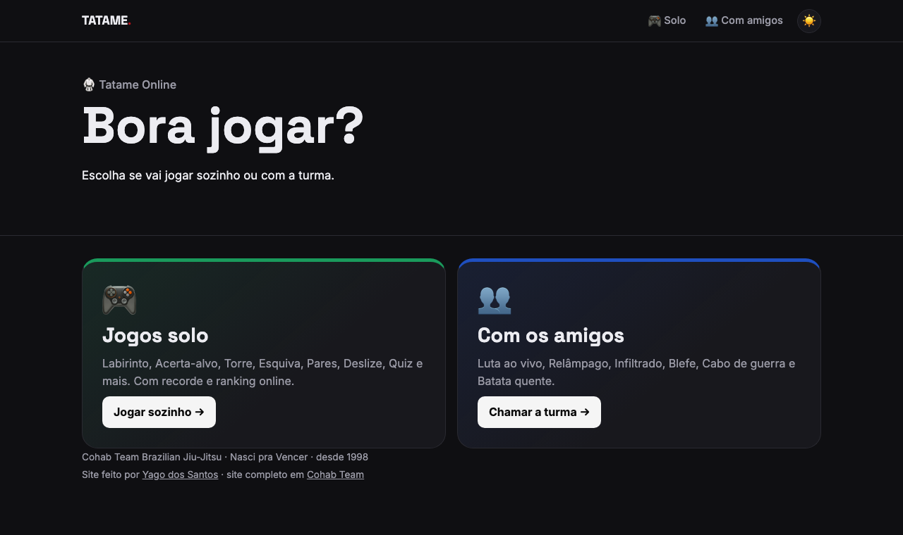

  

  

  
  
  
  

Só os jogos do site da Cohab Team Brazilian Jiu-Jitsu: Luta ao vivo, Qual é a posição?, Caminho da finalização,
Árbitro por um dia, Regra ou mito? e o Quiz. Link separado que pode ser ligado e desligado.
O site completo é https://yagoxavier10.github.io/cohab-team/ (repositório YagoXavier10/cohab-team).

## 📸 Prévia

  

## 🎮 Jogos

| Solo | Com os amigos |
| :-- | :-- |
| 🧩 Labirinto | 🥋 Luta ao vivo |
| 🎯 Acerta-alvo | ⚡ Relâmpago |
| 🗼 Torre | 🕵️ Infiltrado |
| 💨 Esquiva | 🃏 Blefe |
| 🎴 Pares | 🪢 Cabo de guerra |
| ↔️ Deslize | 🥔 Batata quente |
| ❓ Quiz | |

Com recorde e ranking online. 🏆

## 📄 Licença

Distribuído sob a licença MIT. Veja o arquivo [LICENSE](LICENSE).
